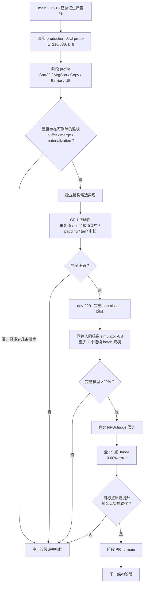

# 面向 Ascend/CANN 的 `sqrt(softplus(x)) + Top-K` 结构性优化研究报告

## Executive Summary

当前 `main` 已经证明了一条非常清晰的经验规律：**在 dav-2201/CANN 9.0 上，真正有效的优化不是把 Top-K 改写成更多普通向量比较，而是尽量保留 `Sort32/MrgSort` 这类专用选择指令，并通过跨行批处理、减少中间候选物化和复用 UB 缓冲区来放大它们的吞吐。**最强证据是 FP32 medium-k case 6 通过整段执行结构替换从约 23.84 μs 降至 10.19 μs，而 values-only 网络虽然去掉了索引负载，却因大量 Gather/Min/Max 变成约 **2.38× 更慢**。fileciteturn8file0L2-L2 fileciteturn9file0L2-L2

对当前尚未改善的 **FP32、k=8、E=210/888（case 13/3）**，我认为优先级最高的下一步不是 radix、阈值筛选或另一套比较网络，而是：**把已经在 FP16 上成功过的“生命周期复用”推广到 FP32——用 `pairB` 在 `Sort32` 前临时承载输入与零索引，排序后再复用为 merge scratch，从而删除两个整行 UB 缓冲，并尝试把 E=210 的 batchRows 从 16 提到 32、E=888 从 4 提到 8。**两种形状在 `Sort32 repeatTimes≤255` 的官方约束下恰好都可做到 224 repeats，因此这是目前最有机制证据的结构候选。fileciteturn5file0 citeturn10search8

第二优先级是 **k=8、E=210 的叶子数感知 merge tree / 零拷贝中间布局**：7 个 `Sort32` 叶子不必按照通用 128/512 元素模板产生大量空槽和中间 prefix pack；可以尝试按真实 7 叶结构组织为 `4+3→2→1`，让下一层直接消费上一层前 8 个 pair。E=888 也可试同一思想，但由于其 28 个 `Sort32` 叶子占比更高，预计收益会低于 E=210。CANN `MrgSort` 最多四路、pair 固定 8 字节且没有“输出到 k 个即停止”的通用参数，因此优化重点应该是**删中间物化和搬运，而不是幻想 MrgSort 本身变成 partial-select**。citeturn19view0

Radix、pivot/filter、sample-guided exact selection 等论文方向值得作为长期研究储备，但现有目标只有 `E≤1024`，且 CANN 9.0 的 A2/A3 路径没有可直接移植 CUDA warp-radix 的 SIMT/warp 原语；项目自身的整行阈值原型也已经说明，一旦破坏跨行统一发射，少排序一些元素并不等于 wall time 更低。citeturn23search0turn22search5turn22academia34 fileciteturn10file0L2-L2

最后，**Issue #52 应与性能优化完全分线处理**。`x=65504` 时参考变换值约 255.937485，恰好位于 FP16 的 `255.875` 与 `256` 中点 `255.9375` 附近，只有约 `1.5×10^-5` 的余量；因此极小的 Sqrt 近似误差就可能把最终 RNE 舍入从 255.875 翻到 256。现有 main 与研究候选都会出现这一现象，raw Top-K 又是正确的，所以首先应做逐阶段数值 probe，而不是把它误判成 selection bug。fileciteturn9file0L2-L2 citeturn25academia46turn24search3

## 项目现状、已知约束与真正的剩余瓶颈

题目的核心数学化简已经做对了：`sqrt(softplus(x))` 对实数单调递增，因此不需要先对全部 `T×E` 元素做 Exp/Ln/Sqrt；可以先在原始 logits 上求 Top-K，再只对 `T×k` 个入选值执行变换。当前仓库的所有生产路径都建立在这个化简上，这已经消除了一个数量级上最明显的冗余，未来不应倒退到“先 transform 全行再排序”。fileciteturn7file0L2-L2

当前 `main` 是单一生产基线，已经通过完整 CANNJudge **15/15，错误占比全部 0.00%**；项目使用 CANN 9.0、`dav-2201` 编译目标，本地仿真采用过 Ascend910B1 simulator，但真实 Judge 的精确 NPU SKU、频率、UB 实际配置没有在现有项目记录中单独给出，所以报告不能把 simulator 的具体型号直接等价为 Judge 硬件。fileciteturn7file0L2-L2 fileciteturn0file0

### 当前 main 性能轮廓

下表均来自**同一次完整生产提交**，不是把不同分支的单点最好成绩拼在一起；Round 6 只是历史参考，跨日期且没有重复测量统计，因此几个百分点以内的变化不应过度解释。fileciteturn8file0L2-L2

| Case | 当前 main | Round 6 历史值 | 粗略变化 | 研究意义 |
|---|---:|---:|---:|---|
| 1 | 2.45 μs | 2.33 μs | 基本同级 | 固定开销主导 |
| 2 | 2.90 μs | 3.77 μs | 约 1.30× | 已较小 |
| **3** | **139.69 μs** | 139.80 μs | **几乎未改善** | **FP32、E=888、k=8；当前重点** |
| 4 | 3.72 μs | 7.80 μs | 约 2.10× | FP16 small-k 成功 |
| 5 | 7.50 μs | 16.63 μs | 约 2.22× | 已明显优化 |
| **6** | **10.19 μs** | 23.95 μs | **约 2.35×** | **结构替换成功范例** |
| 7 | 17.63 μs | 17.73 μs | 基本不变 | 暂非首攻 |
| 8 | 33.46 μs | 86.99 μs | 约 2.60× | 已明显优化 |
| 9 | 27.52 μs | 27.71 μs | 基本不变 | 第二梯队 |
| 10 | 42.30 μs | 244.10 μs | 约 5.77× | 大幅成功 |
| 11 | 51.94 μs | 252.30 μs | 约 4.86× | 大幅成功 |
| 12 | 122.17 μs | 650.44 μs | 约 5.32× | FP16 small-k 已大幅优化 |
| **13** | **176.78 μs** | 176.97 μs | **几乎未改善** | **FP32、E=210、k=8；当前重点** |
| 14 | 537.48 μs | 2.13 ms | 约 3.96× | FP16 medium-k 已大幅优化 |
| 15 | 1.65 ms | 3.46 ms | 约 2.10× | large-k 已有结构优化 |

fileciteturn8file0L2-L2

这张表最重要的不是“哪个 case 绝对时间最长”，而是**哪些测试点对结构优化几乎完全没有响应**。case 3/13 正是这种异常：在大量其他点获得 2–6 倍提升时，这两个 k=8 FP32 点仍停留在 139.69/176.78 μs，因此最新主线计划也把它们定为下一条研究线。fileciteturn3file0L2-L2

### 已经证明有效和无效的路线

| 路线 | 实测 | 结论 |
|---|---|---|
| FP16 keep-4 / keep-12 | case12 176.35→131.23 μs；case14 612.94→558.73 μs | 减少中间候选有效 |
| prefix copy 批量化 | case12 131.20→129.17；case14 558.73→537.77 μs | 有效但边际收益开始变小 |
| final merge 跨行批量化 | case12 129.17→124.97 μs | 证明减少逐行发射有价值 |
| FP16 原生排序 | 124.97→122.41 μs | 小收益，pair 宽度并未随 half 减半 |
| FP32 medium-k 整段替换 | case6 23.84→约10.19 μs | **最重要的结构成功：跨行专用路径** |
| FP32 large-k copy/merge 批量化 | case15 1.69→1.65 ms | 正确，但已进入增量阶段 |
| 整行 threshold + GatherMask | 正态长 batch 最好约 +11.3%，对抗输入反而 -25.5% | 破坏跨行统一发射，停止 |
| values-only 固定比较网络 | 62 行 10.51→24.96 μs；124 行 18.62→44.25 μs | **约 2.38× 退化，停止** |

fileciteturn10file0L2-L2 fileciteturn9file0L2-L2

values-only 的失败尤其具有指导意义：它每 batch 需要约 **54 次拆分 Gather、1 次输出 Gather、82 次 Min/Max**。算法在抽象比较次数上并不荒唐，也保留了跨行 rank plane，但 CANN 的普通向量重排/比较比专用 `Sort32/MrgSort` 组合贵得多，所以“去掉 index”并不自动等于“减少硬件工作”。fileciteturn9file0L2-L2

项目的整行阈值实验说明了另一条边界：T=16 时，候选相对基线的 VBS32 调用从 4 增到 32、VMS4V2 从 12 增到 64、VREDUCEV2 从 4 增到 36、VECTOR BAR 从 78 增到 338。虽然候选每行最终排序的元素减少了，但**每行阈值和候选数不同，原来一次对多行发射的能力被打散**，最终 wall time 只改善 8.8%，对抗分布还退化 25.5%。fileciteturn10file0L2-L2

### 已知约束与未指定项

| 项目 | 当前认知 |
|---|---|
| CANN 版本 | **已知：9.0.x**，本地环境记录为 CANN 9.0.0。fileciteturn7file0L2-L2 |
| 编译架构 | **已知：dav-2201**。fileciteturn7file0L2-L2 |
| Judge 精确硬件 SKU / 频率 | **未指定**；不能把 Ascend910B1 simulator 直接当作真实 Judge SKU。 |
| 输入范围 | 已知 FP16/FP32、`E=64…1024`、`k=1…64`；更细的 logits 统计分布/NaN 合同**未指定**。fileciteturn7file0L2-L2 |
| 输出 | 当前题目/实现只需要 score，production 的 Sort32 index 只是 payload。fileciteturn5file0 |
| 是否允许自定义 kernel | **已知：允许**，仓库当前 production 就是自定义 Ascend C kernel。fileciteturn7file0L2-L2 |
| 是否必须输出有序 Top-K | 当前实现维持有序 merge；**题面合同是否允许 unsorted 在已有记录中没有被单独确认**，所以不能据此做优化假设。 |
| 重复值/极值/尾 batch | **必须正确**；现有 probe 持续覆盖这些情况。fileciteturn9file0L2-L2 |
| 近似 Top-K 是否允许 | 从现有 0.00% error 及项目验证原则看，应按**精确 Top-K**设计；除非比赛合同另有确认，否则近似算法不能进 production。 |
| 人力、时间预算 | **未指定**；下文成本以单人“工程日/实验轮次”给相对估计。 |
| 绝对性能目标 | 没有新的硬性目标；仓库下一阶段已经规定本地完整模型 **≥20%** 才进入 production 候选。fileciteturn3file0L2-L2 |

## 近五年 HPC、Top-K、并行排序与低精度研究的可迁移结论

近几年 GPU Top-K 研究有一个共同趋势：**不再把问题简单理解成“设计更少比较次数的排序”，而是把全局扫描次数、候选物化、同步、批处理规模和片上存储利用率放到与算法复杂度同等甚至更重要的位置。**这一点和我们在 Ascend 上的实测高度吻合。SC23 的 AIR Top-K 通过 iteration fusion 和自适应减少设备访问；RadiK 专门优化 radix 选择的内存带宽和 batch 扩展；2026 年的 Sample-Guided Exact Top-K 甚至把“采样”只用于预测工作量，而通过 mandatory full pass 保证结果仍然精确。citeturn25search0turn22search5turn22academia34

| 工作 | 核心贡献 | 算法/成本模型 | 论文报告结果 | 对当前 Ascend 项目的迁移性 |
|---|---|---|---|---|
| **AIR Top-K / GridSelect, SC23** | 自适应、融合 radix 迭代；GridSelect 用共享队列减少昂贵插入 | 固定字宽下近似 `O(pE)`，重点减少 pass/流量 | AIR 在不同 batch/基线上报告 1.38× 到数十倍甚至更高提升；批量场景收益尤其突出 | **高层思想高**：融合 pass、保留 batch；CUDA 实现本身低可移植。citeturn25search0 |
| **RadiK, ICS 2024** | 可扩展 radix Top-K、batch/adversarial 自适应 | 固定 radix 位宽下线性扫描级，避免 merge-based 的片上容量瓶颈 | 非 batch 最多 2.5×，batch 最多 4.8×，对抗输入自适应最多再 2.7× | **中长期高、近期低**：当前 CANN A2/A3 无直接 radix/SIMT 对应物。citeturn22search5turn24search0 |
| **RTop-K, 2024** | row-wise 二分阈值选择；可 early stop | `O(rE)`，r 为二分/停止轮数 | 无 early-stop 报告 3.936×；early-stop 4.245–9.506× | **算法启发中，当前硬件风险高**：多轮 threshold/count 正是本项目已观察到的同步敏感区。citeturn25academia48 |
| **Approximate Top-k for Increased Parallelism, 2024** | 把行分成交错 buckets，各自选小 `k_b` 再汇总 | 总工作仍近线性，但显著增加独立并行度 | 论文/开源实现报告数倍加速且少量 recall 损失 | **研究价值高、production 基本不可用**：比赛当前要求精确值。citeturn25academia47turn25search2 |
| **Sample-Guided Exact Top-K, 2026** | 固定步长样本预测 coarse boundary；完整扫描负责认证和候选形成，sampling 不影响正确性 | `O(sample)+O(E)+O(C)`，不足时 exact recovery | 20 个配置相对最快验证 exact baseline 为 1.29–1.75×，几何均值 1.55× | **概念很好但当前 E 太小**；更适合十万级长行，E≤1024 时固定开销占比可能过高。citeturn22academia34 |
| **OneSweep radix sort, 2022** | 把 radix 排序的全局 pass / prefix 工作融合，降低内存往返 | `O(pE)` | 核心启示是减少每 digit 全局读写 | **方法论高**：即使不能移植 radix，也说明“少物化一次”往往比少几次比较重要。citeturn14search13 |
| **Vectorized & Performance-Portable Quicksort, 2022** | 使用小规模排序网络和 SIMD 友好的 pivot/partition，跨多 ISA | `O(E log E)`，小块使用固定网络 | 跨多套 SIMD ISA 展示可移植向量排序 | **方法论中、直接迁移低**：A2 没有 AVX/SVE 式任意寄存器 shuffle；values-only 失败正说明 generic network 不一定胜专用指令。citeturn14search15 |
| **CPFloat, 2023** | 系统模拟低精度、subnormal/overflow/rounding 和复合误差 | 数值研究而非 Top-K | 强调低精度必须显式处理边界与舍入 | **#52 高相关**：不能只以平均误差判断 FP16 hard-to-round 点。citeturn24search3 |
| **Inexactness and Correction of Reciprocal/Division/Sqrt, 2024** | 对近似 sqrt 等构造校正方法，满足 IEEE 正确舍入 | refinement/correction | 理论证明近似值可进一步修正为正确舍入结果 | **#52 高相关**：说明“FP32 中间精度够高”并不自动保证后续目标格式正确舍入。citeturn25academia46 |

SC23 和 RadiK 的 batch 数据尤其值得重视。AIR 在 batch=100 时收益远高于许多单 query 结果，RadiK 也明确报告 batch Top-K 的最高加速达到 4.8×；这和本项目 case 6 的经验一致：**跨行统一发射本身就是算法设计的一部分，而不是实现末端的一点微调。**citeturn25search0turn22search5

这也解释了为什么 RTop-K、pivot-filter 和 sample-guided selection 不能仅凭论文数字就移植。GPU 论文里的 ballot、warp reduction、shared-memory queue、persistent block 等机制能够很便宜地完成“每行候选数不同”的控制，而 dav-2201 当前使用的是 SIMD Vector pipeline；一旦每行要独立读取 threshold/count，就可能把统一 `repeatTimes` 拆成大量小调用。项目自己的 threshold A/B 已经直接观测到了这一效应。fileciteturn10file0L2-L2

近似 bucketed Top-K 则应该明确放在**非生产**分支。它的理论优势正是牺牲全局精确 membership 来换并行度，而当前项目的目标是 CANNJudge 精确分数；除非比赛明确允许近似集合，否则这类算法即使快 4× 也不是合法优化。citeturn25academia47turn25search2

## CANN 官方能力、硬件约束与它们对算法选择的影响

CANN 官方接口把当前问题的硬件边界划得非常清楚。`Sort32` 每次固定处理 32 个元素，生成 value/index pair；**无论 value 是 FP32 还是 FP16，排序 pair 都按 8 字节组织**，而 `repeatTimes` 上限为 255。`MrgSort` 可以合并最多四条有序队列，也使用 8 字节 pair；它支持 repeat 批量执行，但 repeat 模式要求列表长度/布局满足固定约束。citeturn10search8turn19view0

这直接解释了一个曾经不明显的事实：**把 FP16 selection 保持在 half，并不会把 Sort32/MrgSort 的中间 pair 流量减半。**当前生产代码在 FP16 原生排序实验中也观察到 pair 仍然是 8 字节，最终只获得约 2% 的局部 Judge 改善；因此“半精度排序”不能再作为主要结构方向。fileciteturn9file0L2-L2

项目当前 production 本身已经把 Huawei A2/A3 `MoeGatingTopKSoftmaxPerf` 的关键 selection 结构吸收进来：**多行一次 `Sort32`、每 32 元素固定保留 top-8、跨行批量 `MrgSort`、输入双缓冲**；GM 仍是紧密行布局，进入 UB 时做 32B 对齐并以 `-inf` 填充到 `ceil(E/32)×32`。这意味着未来优化最好沿着这套专用指令布局继续压缩中间层，而不是重新发明一套普通 Min/Max 排序器。fileciteturn5file0

| CANN 机制 | 官方性质 | 对本项目的直接含义 |
|---|---|---|
| `Sort32` | 32 元素固定排序；pair 8B；repeat≤255；相同值有确定 tie 行为 | 设计 batchRows 时必须同时考虑 UB 和 `255/(inner/32)`；FP16 pair 不更窄。citeturn10search8 |
| `MrgSort` | 最多四路有序队列，repeat 批量合并；pair 8B | 最适合构造固定 k=8 merge tree；但没有通用“输出前 k 就停”的 Top-K 参数。citeturn19view0 |
| `GatherMask` | 可按掩码压缩元素并返回选中计数 | 适合压缩，但 count 依赖可能形成向量→标量同步；项目阈值实验已验证这是实际风险。citeturn10search9 |
| Double Buffer | MTE 搬运可与 Vector 计算通过队列重叠 | 当前 main 已在用，因此“加双缓冲”本身不是新方向；应研究缓冲生命周期和 UB 占用。citeturn16search1 |
| DataCopy | UB 搬运高度依赖 32B 对齐 | 当前生产已经做行 padding；继续优化应减少**次数/中间物化**，而非再重复对齐微调。citeturn23search7 |
| 高层 `TopK` | CANN 9.0 支持 merge-sort 路径，并在特定产品提供 radix-select | 可作为性能 oracle；不能假设 A2 直接拥有与最新 CUDA 相同的 radix backend。citeturn23search5turn11search1 |
| SIMT / warp API | CANN 9.0 `asc_vf_call`、warp shuffle/ballot 在 Atlas A2/A3 标为不支持 | CUDA 的 warp-register Top-K、ballot compaction 不能按源码思路直接搬过来。citeturn23search0turn23search1 |
| FP32→FP16 Cast | CANN 提供显式 RINT 等舍入方式 | 可以显式控制最终 cast；但若 Sqrt 的 FP32 近似已经跨过 half midpoint，正确 RNE 仍会得到另一侧值。citeturn23search10 |

### 一个重要的架构排除结论

RadiK、AIR、FlashInfer native radix、Faiss register selection 等 CUDA 工作非常值得学习，但**“把 CUDA 内核翻译成 Ascend C”不是当前最优路线**。CANN 9.0 官方明确列出 A2/A3 不支持 `asc_vf_call` 这套 SIMT VF 启动和相关 warp 原语；换句话说，CUDA 中最便宜的 ballot/shuffle/register exchange 在当前目标上没有同构的执行模型。citeturn23search0turn23search1

因此，A2 上的高性能 Top-K 更接近：

```text
大批量行
    ↓
32B 对齐 CopyIn / padding
    ↓
一次大 repeatTimes 的 Sort32
    ↓
固定宽度 prefix
    ↓
少层数、少物化的 MrgSort
    ↓
一次 Gather score lanes
    ↓
只对 T*k 做 stable softplus + sqrt
    ↓
Cast / CopyOut
```

这与当前 main 的结构基本一致。真正剩余的空间是：**一批处理多少行、中间 pair 是否必须写出来、通用 merge tree 是否为具体 E 做了多余工作、UB 是否因为生命周期保守而限制了 batch。**fileciteturn5file0

### FP16 极值为什么值得单独处理

Issue #52 中，`x=65504` 的 host 变换约为 `255.937485`，FP16 参考结果为 `255.875`，而 CANN 路径得到 `256`。由于两个相邻 FP16 值的中点是 `255.9375`，参考实值距离中点仅约 `1.5×10^-5`；这属于典型 hard-to-round 输入——一个非常小的 Sqrt 近似偏差就足以改变最终半精度舍入。fileciteturn9file0L2-L2

因此我更倾向于下面这个解释，但要明确它目前只是**有证据支持的推断**：selection 没问题，softplus 在大正数区也不是主要问题；最可疑的是 Sqrt 的 intrinsic 近似值恰好落到了 midpoint 或其上方，然后最终 RNE 合法地把它变成了 256。浮点研究文献也强调，即便中间结果精度较高，接近 rounding breakpoint 的 sqrt 仍可能需要显式 correction 才能保证目标格式正确舍入。citeturn25academia46turn24search3

不应立即把整个 transform 换成昂贵高精度算法。正确做法是先把 `softplus FP32 → sqrt FP32 → half cast` 三个阶段的 bit pattern 单独导出，在完整 FP16 有限输入或至少高端区间上找出真正的错误集合；只有它是系统性问题而非单一 hard case，才值得设计 vectorized correction。

## 开源实现与工程实践的可借鉴部分

开源生态给出的最强共识不是“存在一个万能 Top-K 算法”，而是**按 shape、k、输出合同和硬件后端动态选择算法**。FlashInfer 的 `top_k` 就会根据 shape、dtype、sorted/deterministic 等要求在 native radix、cluster 和 CUB `DeviceBatchedTopK` 间分流；甚至 sorted 或 deterministic 要求会改变可用 backend。citeturn24search2turn24search4

这与我们当前“FP16 small/medium/large-k、FP32 medium/large-k 单独类”的方向完全一致。换句话说，项目不应再追求一个统一 kernel 覆盖 E=64…1024、k=1…64；**专门为 case3/13 的 `FP32+k=8+特定 padded inner` 写一条窄而快的生产路径，是成熟工程而不是 hack。**FlashInfer 的开源实现就是类似的 shape/contract dispatch 思路。citeturn24search2

| 开源工程 | 核心实现策略 | 性能/复现证据 | 对本项目的价值 |
|---|---|---|---|
| **RadiK** | GPU radix selection，自适应 batch / skew | 论文配套 Docker、源码、完整评测脚本；T4 等 CUDA 平台可复现 | 算法思想强；直接代码移植弱。最值得借鉴的是 adaptive/batched 设计与完整 A/B 方法。citeturn24search0turn24search5 |
| **FlashInfer Top-K** | 按 shape/dtype/sorted/deterministic 自动分配 radix / cluster / CUB backend | 活跃工程，接口直接暴露 backend 和语义差异 | **高工程价值**：进一步强化“窄 specialization + fallback”方向。citeturn24search2turn24search4 |
| **Tencent HPC-Ops** | 高性能 LLM 算子；sampler 把 Top-K、Top-P、Softmax 等压成少数 kernels；2026 exact Top-K 又采用 sample-guided certification | 开源，并对应最新精确 Top-K 论文 | Fusion 和减少全局 pass 很有启发，但本题 transform-after-selection 已经融合在单 kernel 内。citeturn24search1turn22academia34 |
| **Graphcore approximate-topk** | interleaved buckets，各 bucket 小 Top-K，再可选 final Top-K | 有 PyTorch/CUDA 开源实现，报告数倍加速 | 适合作为上限实验，不适合当前 exact Judge production。citeturn25search2turn25academia47 |
| **gpu-topk** | bitonic Top-K、radix select、完整 sort 三种经典 CUDA 路线 | 代码简单、可用于理解 crossover | 已较老；适合作为算法参考，不是当前 A2 性能模板。citeturn24search7 |

HPC-Ops 另一个值得注意的工程实践是把 Top-K 和相邻消费者融合，减少重复读 vocabulary。对本题而言，这条原则实际上已经被充分利用：`sqrt(softplus)` 不在 Top-K 之前对整行执行，而是在候选选出以后直接在同一 kernel 内处理 packed `T×k` 结果，所以这里已经没有像 LLM sampler 那样明显的“再融合一个后续 kernel”机会。fileciteturn7file0L2-L2 citeturn24search1

真正可借鉴的是 **contract specialization**：FlashInfer 会因为 sorted/deterministic/tie-break 要求而切换算法；我们的 production 也应该明确区分“只输出 score”“不需要 index”“固定 k=8”“特定 inner=224/896”。只是由于 CANN `Sort32` 的 pair 格式是硬件接口的一部分，“不输出 index”不能简单推导成“中间不携带 index”。citeturn24search4turn10search8

## 可行的结构性优化候选与优先级

综合论文、官方接口和已有失败/成功实验后，我把候选分成以下层级。表中“预期收益”是**工程假设，用于设实验门槛，不是承诺**。

| 优先级 | 候选 | 核心原理 | 预期完整 kernel 收益 | 难度 | 关键依赖 | 主要风险 |
|---|---|---|---:|---|---|---|
| **P0** | **FP32 k=8 的 `pairB` 生命周期复用 + batchRows 翻倍** | Sort32 前用 pairB 两半存 input/index，排序后同一内存再作 merge scratch；删除独立 input/index UB buffer | **10–30%，有机会更高** | 中 | Sort32 repeat、UB、barrier | alias 生命周期错误、UB 仍不够 |
| **P0/P1** | **E=210 的 7-leaf 专用 merge tree + 零拷贝 prefix 布局** | 不按通用 128/512 模板填充和物化；真实 `4+3→2→1` | **5–20% full kernel** | 中高 | MrgSort 四路、布局 | repeat 连续布局限制可能要求转置 |
| **P1** | **E=888 的 batch=8 + node-major merge scratch** | 主要目标不是少一个 merge，而是一次 Sort32/MrgSort 跨更多行发射并减少中间 copy | **10–25%** | 中高 | UB 与 repeat cap | pair 工作集大；Sort32 本身可能已主导 |
| **P1 测量项** | CANN 高层 `TopK` 同形状 oracle | 对 E210/E888、k8 单独测官方 tiling/backend，作为性能下界/结构参照 | 未知 | 低 | TopK API | 很可能仍走同类 merge-sort，不能直接胜 production |
| **P2** | batch-preserving radix / pivot | 只有能在整批行上并行 histogram/count、无逐行 scalar sync 才继续 | 理论潜力高，当前成功概率低 | 高 | 新 primitive/不同硬件 | 重演 threshold 失败 |
| **P2** | Sample-guided exact selection | sample 只预测工作，full pass 认证 exactness | 对当前 E≤1024 预计低 | 高 | 融合 full-pass collector | 固定开销超过省下工作 |
| **禁入 production** | bucket approximate Top-K | 以 recall 换并行 | 可能 2–4× | 中 | 允许近似合同 | 当前 Judge 语义不允许 |
| **独立 P1 correctness** | #52 FP16 hard-rounding probe/correction | 对 selected `T×k` 做 staged bit-level probe，必要时只修 near-boundary | 性能目标不是主要目的 | 中 | Sqrt/Cast 行为 | 校正增加 Div/Compare 等开销 |

### 最值得立刻实现的候选：FP32 scratch 复用

这是本报告最明确的建议。

当前 FP32 generic vendor kernel 为每个 batch 同时保留 staging、`inputBuffer_`、`indexBuffer_`、`pairA`、`pairB` 等多块整行 UB；而 FP16 路径已经成功做过一件更激进的事：**在 Sort32 前把 pairB 暂时当 casted input + zero index scratch，Sort32 完成后再把 pairB 作为 merge buffer 使用，因此可以删除两个整行 buffer 并扩大 batch。**当前源码明确记录了这一设计。fileciteturn5file0

FP32 完全具备类似的生命周期：

```text
CopyIn → staging

pairB[0 : rows*inner]
    = padded/rearranged FP32 input

pairB[rows*inner : 2*rows*inner]
    = uint32 zero payload index

Sort32(
    dst = pairA,
    srcValue = pairB.first_half,
    srcIndex = pairB.second_half,
    repeatTimes = rows * inner / 32
)

Barrier
// 到这里 input 与 index 生命周期结束

BuildFinalPairs(
    pairA,
    pairB   // 整块 pairB 现在重新作为 merge scratch
)
```

这个方案没有引入新的算法语义，也没有普通 Gather/MinMax 网络；它只是**根据数据生命周期减少 UB 常驻集合**。这恰好属于 CANN 上最值得做的“结构优化”。

更有意思的是官方 `Sort32 repeatTimes≤255` 恰好允许两个目标 case 翻倍：

| 目标 | padded inner | 每行 Sort32 repeats | 当前通用 batch cap | 候选 batch | 总 repeats |
|---|---:|---:|---:|---:|---:|
| case 13，E=210 | 224 | 7 | 16 | **32** | **224 ≤ 255** |
| case 3，E=888 | 896 | 28 | 4 | **8** | **224 ≤ 255** |

`Sort32` 的 255 上限来自官方 API；当前 production 的 batch 容量也正是按 inner 分段设为 16/8/4。换句话说，**两处目标都恰好拥有“batch×2 而不会触碰 repeat 上限”的空间，只差 UB 容量能否通过 alias 释放出来。**citeturn10search8 fileciteturn5file0

这比“调 batchRows=17/5”要结构化得多：它删除了整类存储，再用释放出来的资源提高跨行吞吐。

### 第二候选：让 merge tree 感知真实叶子数

对 E=210，padding 后 inner=224，只有 **7 个 32 元素 Sort32 leaf**。任何精确 Top-8 都满足：

\[
Top8(A\cup B)=Top8(Top8(A)\cup Top8(B))
\]

因此不需要把 7 个叶子强行套进面向 128/512/1024 的通用层级。

一个概念实现是：

```text
L0 ... L6 = Sort32(each 32 values)

A = MrgSort4(top8(L0), top8(L1), top8(L2), top8(L3))
B = MrgSort3(top8(L4), top8(L5), top8(L6))

result = MrgSort2(top8(A), top8(B))
```

实际难点不在数学，而在 **如何让 A/B 的 top-8 在 UB 中天然处于下一次 `MrgSort` 需要的位置**。如果每层仍然先 `DataCopy` 一个 prefix 到新 buffer，收益会迅速回到 incremental；真正的候选必须尝试 node-major/chunk-major 布局，使上一层输出的前 8 pair 可直接成为下一层 src pointer。`MrgSort` 的四路、repeat、连续布局约束决定了这个实验是否能成立。citeturn19view0

E=888 有 28 个 leaf，可以做：

```text
28 leaves
 → 7 × merge4
 → merge4 + merge3
 → merge2
```

但这里至少有 28 个 `Sort32` repeats/row，本身占比更高，而且现有 generic tree 已比较接近合理层数，所以 E=888 更应先做 batch×2，再根据 profile 决定是否值得改 merge tree。

### 不应优先做的三件事

**不要继续做另一个 values-only sorting network。**已有完整模型不是差 5%，而是慢 **2.38×**；这已经足以否定“普通 Gather + MinMax 替换 Sort32/MrgSort”的当前实现家族。fileciteturn9file0L2-L2

**不要立即做多轮 radix/pivot threshold。**CANN 9.0 的目标 A2/A3 不具备 CUDA 风格 warp SIMT 原语，现有 GatherMask threshold 路线又已经证明 scalar count / row-dependent control 会摧毁 batch 发射优势。除非新的设计首先解决这一机制问题，否则只是重复实验。citeturn23search0 fileciteturn10file0L2-L2

**不要把 approximate bucket Top-K 当比赛优化。**它的论文收益确实很诱人，但收益来源正是容忍 membership error；这和当前 Judge 的 exact score 合同不是同一个问题。citeturn25academia47

## 实验流程、基准门槛与短中长期路线

实验原则应继续维持仓库现在的做法：**先完整 production-path A/B，再看 simulator/profile，只有结构改善达到门槛才让你上 Judge。**这是必要的，因为项目已经多次看到“局部指令少了”却没有转化成真实 Judge 收益。fileciteturn3file0L2-L2



这个 20% simulator/full-model 门槛与当前仓库的最新计划一致；它并不是说 simulator 能预测 Judge 百分比，而是用来防止又花一轮 Judge 时间测试只有 2–5% 模型收益的局部改动。fileciteturn3file0L2-L2

### 建议的新基准矩阵

对于 **E=210/k=8**，应以 padded inner=224 为真实计算形状，至少跑 batch 边界 `T_local=1、15、16、17、31、32、33、64、96/128`，同时加入多核不能整除的总行数。对于 **E=888/k=8**，核心边界应围绕 batch 4→8：`1、3、4、5、7、8、9、16、32`。每组都必须使用同一输入、同一核数分别跑 main 和 candidate。

正确性数据分布至少包括：随机正态/均匀、全相等、首段集中最大值、尾段集中最大值、跨 `Sort32` block 的并列值、`-inf`、极大正/负值、padding 周围最大值、尾 batch。这里并不是为了模拟 Judge 分布，而是保证结构算法对数据分布没有隐藏假设；项目过去的 threshold 和 values-only 研究已经证明这种对抗输入非常有价值。fileciteturn9file0L2-L2 fileciteturn10file0L2-L2

性能指标不应只记录 kernel duration。建议同时保存：

| 指标 | 目的 |
|---|---|
| kernel duration / running time | 最终是否真的快 |
| `Sort32` 调用数与总 repeats | 判断 batch 放大是否生效 |
| `MrgSort` 调用数与 repeats | 判断 merge 层是否真正删除 |
| DataCopy / Gather 次数 | 识别中间物化成本 |
| Vector Barrier 数量 | 防止“少算、多等” |
| 每 batch UB 字节数 | 验证 scratch reuse 是否真实释放资源 |
| batchRows / active cores | 判断尾部和短输入是否损害并行度 |
| CopyIn/Compute/CopyOut 时间线 | 确认双缓冲仍有重叠 |
| median / p95 或至少多次重复范围 | 防止 2–3% 噪声被当成收益 |

CANN 官方 profiler/trace 能对 kernel 区段和 vector pipeline 做分析；项目已有 simulator/profile 流程，应继续沿用而不是靠单条 API 理论成本推断 wall time。citeturn8search1

### 推荐的验收门槛

**本地正确性：**所有 production probe 逐项匹配参考；raw Top-K 对重复值、极值、padding、尾 batch 精确通过。

**本地性能：**至少两个连续 batch 规模完整路径 `duration` 改善 **≥20%** 才进入 Judge，这是现有项目约定；短输入不能出现明显大幅退化。fileciteturn3file0L2-L2

**真实 Judge：**15/15 Pass、错误占比 0.00%；目标 case 至少应看到约 **15% 以上**的稳定改善才值得增加生产 specialization，其他不相关 case 建议以 **3% 左右**作为需要复测的警戒线，而不是看到单次 1–2% 波动就判回归。这个 15%/3% 是本报告建议的工程判据，不是比赛官方阈值。

**#52 数值线：**不要通过放宽现有严格 probe 来“修复”。先输出中间 FP32 bit pattern，并对 FP16 高值区或全部有限 half 输入做高精度 reference sweep；只有确定 CANN transform 和目标合同不一致，才设计 correction。当前 Judge 15/15 的事实本身不能证明 65504 边界在所有合法输入合同下没有问题。fileciteturn9file0L2-L2

### 短中长期路线

| 阶段 | 里程碑 | 结束条件 |
|---|---|---|
| **短期：下一轮** | case3/13 production probe；测 UB；实现 FP32 `pairB=input+index→merge scratch`；batch 16→32 / 4→8 | 两种形状完整模型均达到预设门槛，或明确证明 UB/吞吐不支持 |
| **短期后半** | 若 E210 merge/profile 占比仍高，实现真实 7-leaf tree 与 node-major layout | 删除至少一整层 pack/materialization，而不是仅少一两次 copy |
| **中期** | Judge 验证成功候选；单独完成 #52 staged numerical probe | production 15/15；数值问题能定位到具体 Exp/Ln/Sqrt/Cast 阶段 |
| **中期备用** | 官方 `TopK` 同形状 microbenchmark，评估 vendor 高层实现 crossover | 获得 A2 merge-sort 的性能 oracle，不一定进入 production |
| **长期** | 若硬件/CANN 升级带来可用 radix/SIMT，重新评估 AIR/RadiK；若 E 扩大到长行，再评估 sample-guided exact | 有新的硬件机制或问题规模变化后才重启 |
| **仅研究** | approximate bucket Top-K | 只有题目合同明确允许 membership approximation 才进入生产评估 |

这条路线与最新仓库计划的方向一致，但把“完整生产路径审计”进一步收敛成了一个更具体、可证伪的假设：**先验证 FP32 k=8 是否能像 FP16 一样通过 scratch lifetime reuse 把跨行 batch 整体翻倍。**最新仓库计划本身也要求避免继续靠调 batch 常数、少屏障等小改动，而要寻找删除 merge 层或 pair 往返的结构变化。fileciteturn3file0L2-L2

## 可直接执行的三条优先行动建议

| 优先行动 | 预期成本 | 风险 | 成功判定标准 |
|---|---|---|---|
| **立即做：FP32 k=8 `pairB` 生命周期复用，并尝试 case13 batchRows=32、case3 batchRows=8。** Sort32 前 `pairB` 两半分别存 padded FP32 input 与 zero index；Sort32 barrier 后整块重用为 merge scratch。 | **约 0.5–1.5 工程日**：production probe、实现、CPU/设备编译、两组 simulator A/B | **中等**：主要是 UB alias 生命周期、CPU checker 和尾 batch；算法正确性风险比新 selection 算法低 | E210/E888 raw/full probes 全通过；两种连续 batch 尺寸完整模型至少一处 ≥20%、另一处有明确正收益；目标 `Sort32 repeatTimes=224`，完整 submission 编译通过。官方 repeat 上限允许这一配置。citeturn10search8 |
| **随后做：只针对 E=210/k=8 的 7-leaf 零拷贝 merge tree。** 不再沿用通用 128/512 层级；验证 `4+3→2`，并让上一层 top-8 prefix 尽量直接成为下一层 MrgSort 输入。 | **约 1–2 工程日**：需要较仔细的 UB layout 和 repeat 验证 | **中高**：MrgSort repeat 的连续布局/等长约束可能迫使额外重排，从而抵消收益 | 相比“只做 batch×2”的新基线，`MrgSort/DataCopy` 指令结构出现整层删除；E210 完整模型额外 ≥10–15% 才保留，否则立即归档，不调几十个小参数。citeturn19view0 |
| **并行但不阻塞性能线：完成 #52 的 FP16 hard-rounding microscope。** 对 `softplus→sqrt→cast` 各阶段导出 FP32/FP16 bit pattern，重点扫 65504 附近以及全部有限 FP16 值的高精度 reference；暂不改 production 容差。 | **约 0.5–1 工程日** | **低到中**：debug probe 本身风险低；真正 correction 若需要高精度 Div/残差判定会带来性能成本 | 能明确回答“误差来自 Sqrt 还是 Cast”；raw selection 继续精确；若实现 correction，应使全部目标边界匹配 reference，同时 FP16 主路径性能退化控制在约 3% 内并保持 Judge 15/15。fileciteturn9file0L2-L2 citeturn25academia46turn24search3 |

综合所有证据，**第一条是现在最值得实际写代码的方向**。它不是来自“再猜一个 Top-K 算法”，而是来自三组相互独立的证据：CANN 官方 `Sort32` 的 repeat 约束恰好容许两个目标形状 batch 翻倍；FP16 已经在同一仓库证明过“复用 pair scratch→释放 UB→扩大跨行 batch”的可行性；近年的 AIR/RadiK 以及本项目 case6 又都共同说明，在 Top-K 上**维持大批量、减少 pass 和中间物化**比把专用排序拆成大量普通比较更可靠。citeturn10search8turn25search0turn22search5 fileciteturn5file0